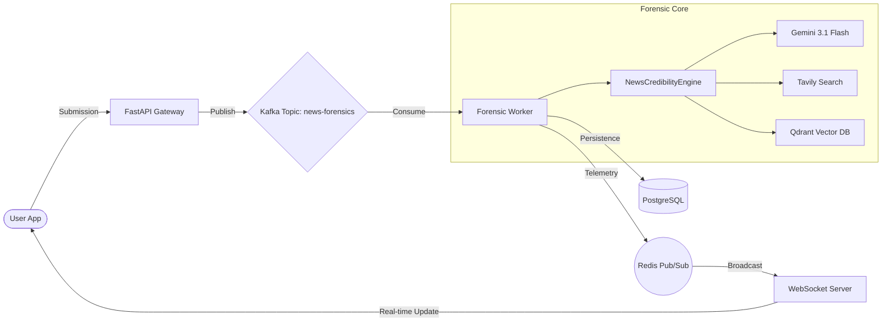
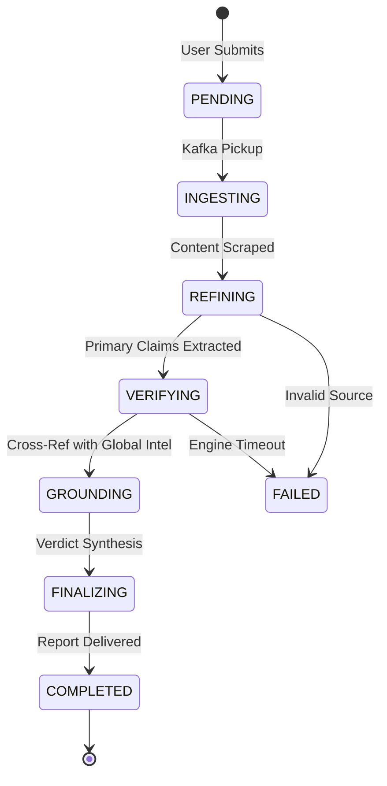
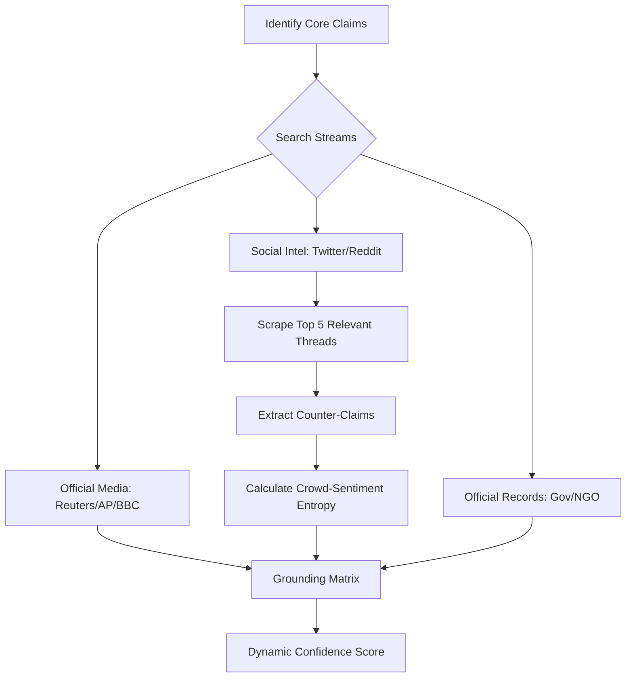

# Factline: High-Fidelity Forensic Intelligence Platform

Factline is a state-of-the-art, multi-modal news verification platform designed to combat modern digital disinformation. By combining distributed systems architecture (Kafka/Redis) with cutting-edge AI (Gemini 3.1) and forensic grounding, Factline provides investigative journalism tools at consumer scale.

---

## 🚫 The Problem Statement
In an era of deepfakes, algorithmic bias, and high-speed information voids, the "Truth" has become an elusive commodity.

| Challenge | Impact on Society | Factline Intervention |
| :--- | :--- | :--- |
| **News Fragmentation** | Information travels via unverified links; source origin is lost. | **Source Origin Audit**: Recursive scraping to find the parent domain. |
| **Breaking News Voids** | Rumors fill the gap before official reports are released. | **Uncertainty Engine**: Detects data voids and flags "Emerging Intel." |
| **Neural Manipulation** | AI media is indistinguishable from reality. | **Multi-Modal Hub**: GAN artifact detection & metadata integrity checks. |
| **Opaque Verification** | Users are told "Fact Check: False" without proof. | **Forensic Transparency**: Full access to scraped sources & reasoning. |

---

## ⚖️ The Solution
Factline transforms news consumption into a **Forensic Ingestion** process. Submission is not just "reading"—it's an autonomous, multi-stage digital audit.

---

## 🔄 Core Architecture & Data Flow

### 1. High-Level System Architecture


### 2. The Investigative HUD State Machine


### 3. Social Media Scouting Pipeline


---

## 📊 Forensic Scoring Matrix
Claims are measured across multiple vectors to produce the final **Credibility Score**.

| Signal Category | Weight | Positive Indicators (Trust Signals) | Negative Indicators (Red Flags) |
| :--- | :---: | :--- | :--- |
| **Source Authority** | 30% | Whitelisted domain, HTTPS, Primary source. | Blacklisted domain, Suspicious TLD, No contact info. |
| **Grounding Depth** | 40% | Official rebuttals, Peer-verified, Data-backed. | Isolated report, Contradicts official records. |
| **Social Context** | 15% | Community-verified (Twitter Notes), Reddit context. | Highly polarized sentiment, Bot-like spread patterns. |
| **Neural Integrity** | 15% | Consistent lighting, No GAN artifacts, Metadata valid. | Frequency inconsistencies, Metadata missing/stripped. |

---

## ⚖️ Audit Verdict Tiers
The final Forensic Verdict is categorized based on the confidence of the grounding matrix.

| Verdict | Confidence Range | Meaning to User | UI Indicator |
| :--- | :---: | :--- | :--- |
| **VERIFIED** | 85% - 100% | Information is backed by multiple primary sources. | Blue Badge |
| **VETTED** | 60% - 84% | Generally accepted but lacks multiple official streams. | Green Badge |
| **UNCERTAIN** | 40% - 59% | **Emerging Intel**. Data is scarce or fast-moving. | Yellow Banner |
| **CONTROVERSIAL** | 20% - 39% | Sources are in direct conflict. Verification stalled. | Orange Warning |
| **REFUTED / FRAUD**| 0% - 19% | Narrative is factually incorrect or AI-manipulated. | Red Alert |

---

## 👥 Integrated User Flow

### 1. Contextual Ingestion
- **Input Types**: URL, Photo of a screen, or Raw Text.
- **Narrative Binding**: Users can provide their own "suspicions" to help the AI focus on specific logical flaws.

### 2. Live Investigative HUD
- The UI glows with a "Forensic Scan" animation.
- A vertical timeline lights up dynamically as the Kafka Workers process each layer of intelligence.
- Users see specific claims appear in real-time before the final verdict is reached.

### 3. Deep Forensic Audit (The transparency layer)
Users can dive beneath the summary into the **Forensic Report Screen**:
- **Scraped Intel Hub**: Interactive cards for every source found (Twitter, Reddit, News).
- **Evidence Chain**: A numbered logical breakdown of the audit.
- **Raw Telemetry**: A terminal-style view of the raw algorithm output.

---

## 🚀 Infrastructure Configuration

### Kafka Topics
- `news-forensics`: Primary processing queue.
- `media-analysis`: Heavy-duty image processing offload.

### Redis Channels
- `forensic_updates_{id}`: Real-time worker-to-UI telemetry.

---

## 🛠 Getting Started

1. **Environmental Configuration**: Set your `GOOGLE_API_KEY` and `TAVILY_API_KEY` in `.env`.
2. **Infrastructure Launch**:
   ```bash
   docker compose up -d --build
   ```
3. **Mobile Launch**:
   ```bash
   flutter pub run build_runner build --delete-conflicting-outputs
   flutter run
   ```

---

## 🛡 License
Proprietary Intelligence Core — Factline Forensic Hub# factline-code_wizards