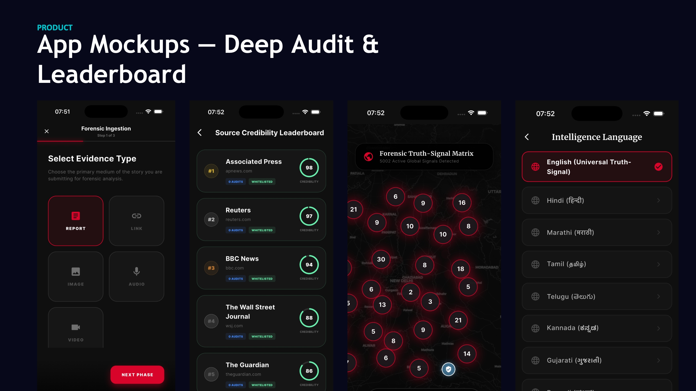
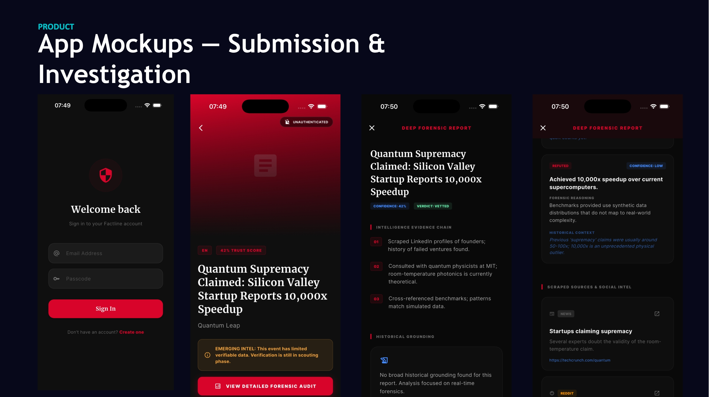
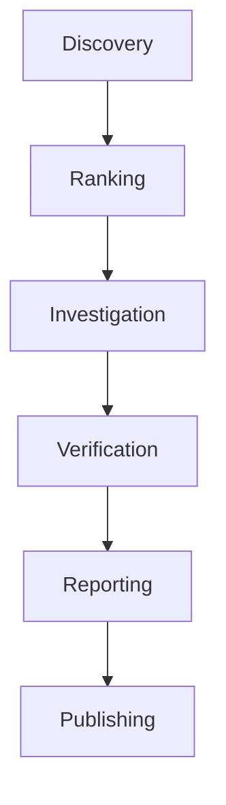
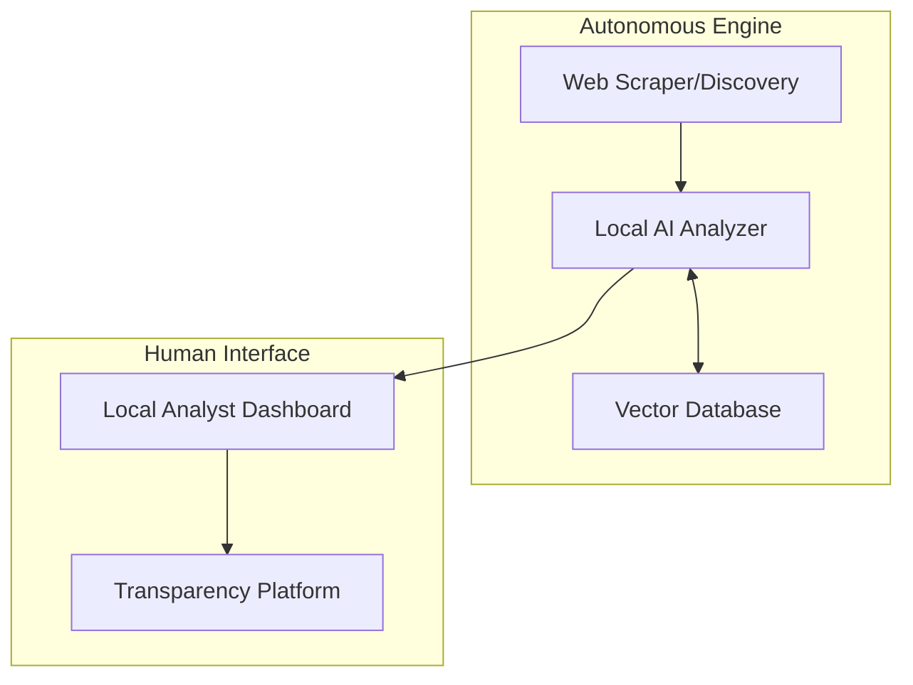

# Factline

**Tagline:** Autonomous Intelligence Discovery, Investigation & Verification Platform

Factline began as a multi-modal news verification platform focused on validating user-submitted content. The project has since evolved into a local-first intelligence operating system capable of discovering, investigating, verifying, and publishing evidence-backed reports autonomously.

---

## Evolution of Factline

Factline began as a multi-modal news verification platform focused on validating user-submitted content.

The project has since evolved into a local-first intelligence operating system capable of discovering, investigating, verifying, and publishing evidence-backed reports autonomously.

---

## Factline V1 (Legacy)

### Factline V1 Interface



_Factline V1 Interface - Verification Dashboard_



_Factline V1 Interface - Multi-Modal Analysis_

The original Factline platform focused on:

- User-submitted verification
- Multi-modal analysis
- News verification
- Forensic scoring
- Transparency-focused design

The original system solved the problem of opaque verification and information voids by allowing users to submit claims for distributed digital audits.

_(See [docs/v1/README.md](docs/v1/README.md) for legacy documentation.)_

---

## Why Factline Evolved

User-submitted verification, while powerful, has fundamental limitations in the modern information ecosystem.

- **Information Overload**: Users cannot manually submit every emerging claim.
- **Emerging Discussions**: Critical intelligence often forms in niche communities before reaching mainstream awareness.
- **Misinformation Velocity**: False narratives spread faster than they can be manually verified.
- **Need for Proactive Intelligence Gathering**: To effectively combat disinformation, a system must discover and analyze claims autonomously, before they cause harm.

This led to the transition to Factline V2.

---

## Factline V2 (Current)

Factline is now an autonomous intelligence engine that:

- Discovers discussions
- Ranks opportunities
- Investigates claims
- Collects evidence
- Verifies information
- Generates reports
- Publishes transparent research

_(See [docs/v2/factline_2.0.md](docs/v2/factline_2.0.md) for current specifications.)_

---

## Core Workflow



---

## Key Features

- **Intelligence Discovery**: Autonomous scouting of emerging narratives.
- **Recursive Investigations**: Multi-layered search and analysis.
- **Evidence Graphs**: Visual representation of claims and grounding sources.
- **Source Auditing**: Recursive validation of origin domains.
- **Local AI Inference**: Secure and cost-effective processing using local models.
- **Transparency Reports**: Full access to the evidence and reasoning behind verdicts.
- **Analyst Dashboard**: A dedicated interface for human operators.
- **Public Report Platform**: A portal for publishing verified findings.
- **Knowledge Memory**: Persistent storage of past investigations and entities.
- **Human-in-the-Loop Publishing**: Final review by human analysts before public release.

---

## Architecture



---

## Technology Stack

- **Backend**: FastAPI, Python
- **Frontend**: Flutter (Dashboard), Web (Public Platform)
- **Database**: PostgreSQL, Qdrant (Vector DB)
- **AI Models**: Gemini 3.1, Local LLMs
- **Infrastructure**: Docker, Nginx
- **Browser Automation**: Playwright/Selenium

---

## Local Analyst Dashboard

The Local Analyst Dashboard is the primary interface for human operators to monitor autonomous investigations, review evidence graphs, and authorize the publication of intelligence reports.

_(Screenshots coming soon)_

---

## Public Transparency Platform

The Public Transparency Platform is where verified reports are published for public consumption, featuring complete evidence chains and source auditing details.

_(Screenshots coming soon)_

---

## Project Structure

```text
factline/
├── assets/
│   └── screenshots/       # V1 and UI Screenshots
├── docs/
│   ├── v1/                # Legacy documentation and architecture
│   └── v2/                # Current specifications and architecture
├── backend/               # Core intelligence engine and APIs
├── lib/                   # Flutter application code
├── web/                   # Web platform assets
└── docker-compose.yml     # Infrastructure configuration
```

---

## Getting Started

### Installation

1. Clone the repository.
2. Ensure you have Docker and Flutter installed.
3. Configure environment variables (e.g., API keys).

### Configuration

Set the required environment variables in a `.env` file at the root.

### Running

Start the backend infrastructure:

```bash
docker compose up -d --build
```

Start the application:

```bash
flutter run
```

---

## Roadmap

- **Factline V1**: Multi-modal verification, forensic scoring, mobile app launch. (Completed)
- **Factline V2**: Autonomous discovery, local inference, public reporting platform. (In Progress)
- **Future Plans**: Decentralized intelligence sharing, real-time video forensics.

---

## Design Principles

- **Local First**: Prioritizing local inference for security and speed.
- **Transparent**: Exposing the entire reasoning chain.
- **Evidence Based**: Grounding all verdicts in auditable sources.
- **Human Supervised**: Ensuring final publication rests with human analysts.
- **Cost Efficient**: Optimizing API calls and utilizing local models.
- **Open Architecture**: Building modular components for future expansion.
