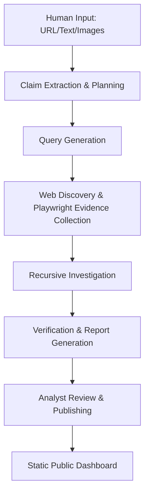

# Factline

**Tagline:** Human-Guided Intelligence Investigation Platform

> _In an era where misinformation spreads faster than human analysts can track, the truth needs an interactive defender. Enter Factline: a human-guided intelligence investigation platform. The human provides the starting signal, and Factline's autonomous engine takes over. It deploys headless browser agents to cross-reference evidence against authoritative sources, recursively investigate claims, and synthesize verifiable, transparent reports._

Factline began as a multi-modal news verification platform focused on validating user-submitted content. It then briefly evolved into an autonomous discovery engine. Today, Factline V2.1 stands as a powerful hybrid: an intelligence operating system that pairs human direction with autonomous recursive evidence collection, verification, and report generation.

---

## Evolution of Factline

### Factline V1 (Legacy)

The original Factline platform focused on user-submitted verification via a Flutter mobile application. It solved the problem of opaque verification and information voids by allowing users to submit claims for distributed digital audits.


_Factline V1 Interface - Verification Dashboard_


_Factline V1 Interface - Multi-Modal Analysis_


### Factline V2 (Current)

User-submitted verification has fundamental limitations in the modern information ecosystem due to information overload and the sheer velocity of misinformation.

Factline V2 is an autonomous intelligence engine that operated proactively, focusing on discovering content automatically.

### Factline V2.1 (Current)

The current architecture shifts the primary entrypoint from autonomous discovery to investigator-guided analysis. We recognized that the most effective investigations start with human intuition, while the heavy lifting of evidence collection is best left to AI. Discovery remains an optional module, but Factline is now built to optimize for: *"Investigate this"* rather than *"Find something to investigate"*.

- Human operators initiate investigations via URL, text, or screenshots
- Factline extracts claims and plans the investigation
- Conducts recursive search using Playwright to visit sources, extract citations, and find referenced materials
- Collects and archives verifiable evidence
- Generates evidence-backed consensus reports and concise comments
- Publishes transparent research to a decentralized static dashboard

---

## Architecture & Technology Stack

Factline V2 employs a highly modular, decoupled architecture:

### 1. Intelligence Engine (Backend)

- **Stack**: FastAPI, Python, SQLAlchemy, PostgreSQL, Loguru
- **Function**: The brain of the operation. It runs the automated pipeline (Claim Extraction -> Planning -> Playwright Evidence Gathering -> Verification -> Report Generation) and exposes REST endpoints for the Analyst Dashboard.

### 2. Analyst Dashboard (Frontend)

- **Stack**: React, TypeScript, Vite, TailwindCSS
- **Function**: The command center for human operators and the primary operating interface. Analysts can submit new investigations, monitor the evidence graph, view every source collected in the Source Explorer, and formally publish final reports.

### 3. Public Dashboard (Frontend)

- **Repository**: [factline.one](https://github.com/pratyakshkwatra/factline.one)
- **Function**: A highly resilient, decentralized public interface. It reads directly from static JSON files generated by the intelligence engine. There is no central API dependency, ensuring that published intelligence remains robust and transparently verifiable.

---

## Core Workflow



---

## Project Structure

```text
factline_ai/
├── intelligence-engine/   # Core Python FastAPI backend and pipeline logic
├── analyst-dashboard/     # React application for human operators
├── docs/                  # Architecture specifications
└── factline               # Root CLI launcher script
```

---

## Getting Started

### Prerequisites

- Node.js (v18+)
- Python (3.10+)
- PostgreSQL

### Installation

1. **Clone the repository:**

   ```bash
   git clone https://github.com/pratyakshkwatra/factline.git
   cd factline
   ```

2. **Setup the Python Environment:**

   ```bash
   cd intelligence-engine
   python3 -m venv .venv
   source .venv/bin/activate
   pip install -r requirements.txt
   cd ..
   ```

3. **Install Dashboard Dependencies:**
   ```bash
   cd analyst-dashboard && npm install && cd ..
   ```

### Running Factline

The easiest way to boot the entire Factline ecosystem (Backend, Analyst Dashboard, and Public Dashboard) is to use the root CLI script:

```bash
./factline serve
```

This will automatically launch:

- **Intelligence API**: `http://localhost:8000`
- **Analyst Dashboard**: `http://localhost:5173`

### Interacting with the Pipeline

You can run individual pipeline commands using the python CLI:

```bash
cd intelligence-engine
source .venv/bin/activate
python3 app/cli.py --help
```

Commands include:

- `factline investigate`: Interactive workflow to paste content/URL and begin an investigation.
- `factline investigate <url>`: Automatically fetch and investigate a specific URL.
- `python3 app/cli.py run`: Execute the intelligence pipeline.
- `python3 app/cli.py status`: Check database and API health.
- `python3 app/cli.py sync`: Manually sync the static SQLite database.

---

## Design Principles

- **Local First**: Prioritizing local inference for security and speed.
- **Transparent**: Exposing the entire reasoning chain, not just the verdict.
- **Evidence Based**: Grounding all verdicts in auditable primary sources.
- **Human Supervised**: Ensuring final publication rests with human analysts.
- **Decentralized Publication**: Utilizing static DB files for public dashboards to prevent censorship or downtime.
