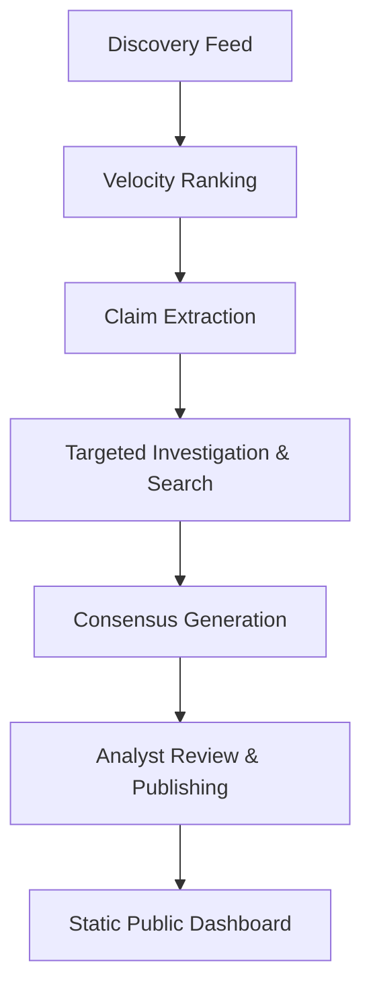

# Factline

**Tagline:** Autonomous Intelligence Discovery, Investigation & Verification Platform

Factline began as a multi-modal news verification platform focused on validating user-submitted content. The project has since evolved into a local-first intelligence operating system capable of discovering, investigating, verifying, and publishing evidence-backed reports autonomously.

---

## Evolution of Factline

### Factline V1 (Legacy)

The original Factline platform focused on user-submitted verification via a Flutter mobile application. It solved the problem of opaque verification and information voids by allowing users to submit claims for distributed digital audits. 

The V1 source code has been preserved in the `legacy-v1/` directory.

### Factline V2 (Current)

User-submitted verification has fundamental limitations in the modern information ecosystem due to information overload and the sheer velocity of misinformation.

Factline V2 is an autonomous intelligence engine that operates proactively. It:
- Discovers discussions from global sources
- Ranks opportunities based on velocity
- Investigates claims using recursive search
- Collects and archives verifiable evidence
- Generates evidence-backed consensus reports
- Publishes transparent research to a decentralized static dashboard

---

## Architecture & Technology Stack

Factline V2 employs a highly modular, decoupled architecture:

### 1. Intelligence Engine (Backend)
- **Stack**: FastAPI, Python, SQLAlchemy, PostgreSQL, Loguru
- **Function**: The brain of the operation. It runs the automated pipeline (Discovery -> Ranking -> Extraction -> Investigation -> Report Generation) and exposes real-time WebSocket feeds and REST endpoints.

### 2. Analyst Dashboard (Frontend)
- **Stack**: React, TypeScript, Vite, TailwindCSS
- **Function**: The command center for human operators. It provides a real-time window into the intelligence engine's operation, allowing analysts to monitor the evidence graph, track running investigations, and formally publish final reports.

### 3. Public Dashboard (Frontend)
- **Stack**: React, TypeScript, Vite, TailwindCSS, WebAssembly (sql.js)
- **Function**: A highly resilient, decentralized public interface. It reads directly from a static SQLite database (`public_reports.db`). There is no central API dependency, ensuring that published intelligence remains robust and transparently verifiable.

---

## Core Workflow



---

## Project Structure

```text
factline/
├── intelligence-engine/   # Core Python FastAPI backend and pipeline logic
├── analyst-dashboard/     # React application for human operators
├── public-dashboard/      # React application for public static reporting
├── legacy-v1/             # Preserved V1 Flutter mobile app and Docker configs
├── docs/                  # Architecture specifications
└── factline               # Root CLI launcher script
```

---

## Getting Started

### Prerequisites
- Node.js (v18+)
- Python (3.10+)
- PostgreSQL

### Installation

1. **Clone the repository:**
   ```bash
   git clone https://github.com/pratyakshkwatra/factline.git
   cd factline
   ```

2. **Setup the Python Environment:**
   ```bash
   cd intelligence-engine
   python3 -m venv .venv
   source .venv/bin/activate
   pip install -r requirements.txt
   cd ..
   ```

3. **Install Dashboard Dependencies:**
   ```bash
   cd analyst-dashboard && npm install && cd ..
   cd public-dashboard && npm install && cd ..
   ```

### Running Factline

The easiest way to boot the entire Factline ecosystem (Backend, Analyst Dashboard, and Public Dashboard) is to use the root CLI script:

```bash
./factline serve
```

This will automatically launch:
- **Intelligence API**: `http://localhost:8000`
- **Analyst Dashboard**: `http://localhost:5173`
- **Public Dashboard**: `http://localhost:5174`

### Interacting with the Pipeline

You can run individual pipeline commands using the python CLI:
```bash
cd intelligence-engine
source .venv/bin/activate
python3 app/cli.py --help
```
Commands include:
- `python3 app/cli.py run`: Execute a full intelligence pipeline cycle.
- `python3 app/cli.py status`: Check database and API health.
- `python3 app/cli.py sync`: Manually sync the static SQLite database.

---

## Design Principles

- **Local First**: Prioritizing local inference for security and speed.
- **Transparent**: Exposing the entire reasoning chain, not just the verdict.
- **Evidence Based**: Grounding all verdicts in auditable primary sources.
- **Human Supervised**: Ensuring final publication rests with human analysts.
- **Decentralized Publication**: Utilizing static DB files for public dashboards to prevent censorship or downtime.
